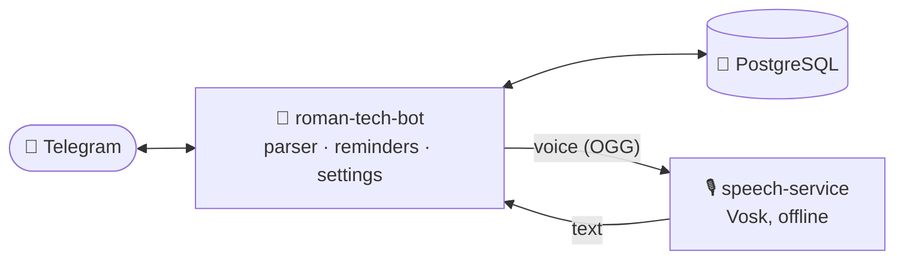

<div align="center">

# 🤖 Roman Tech Bot

**A personal assistant on Telegram. Set reminders by typing or speaking, in plain English.**

[](https://github.com/qetlife/roman-tech-bot/actions/workflows/deploy.yml)
[](LICENSE)


[User guide](docs/user-guide.md) · [Development guide](docs/development.md) · [Setup & deployment](docs/setup.md) · [Roadmap](https://github.com/qetlife/roman-tech-bot/issues)

</div>

---

```text
You  › remind me on thursday at 21.20 to call mom
Bot  › ⏰ Got it: call mom
       🗓 Thu 22 Oct, 21:20 (in 4 d 23 h)
       [↩️ Undo] [✏️ Edit] [👎 Wrong]

        … Thursday, 21:20 …

Bot  › ⏰ call mom
       [✅ OK] [💤 10 min] [💤 1 h]
```

## ✨ Features

- **🗣 Natural language.** “in 2 hours”, “tomorrow at 9”, “friday 18:00”,
  “dec 24”, “at half past six”, “tonight”, and forgiving of typos (“remid me
  tomorow”). No commands or forms to fill in.
- **🎙 Voice messages.** Say anything you'd type. It's transcribed offline on
  the bot's own server by [speech-service](https://github.com/qetlife/speech-service)
  (Vosk), so your audio never goes to a third party.
- **🔁 Recurring reminders.** Daily, weekdays, “every mon and thu”, “every 2
  hours”, “on the 1st of every month”.
- **✅ Delivered until you confirm.** Reminders come with OK and snooze
  buttons and are re-sent until you answer. Quiet hours keep the night free.
- **📅 Events, with reminders that follow them.** “event padel every
  thursday at 21:00”, then “remind me 30 min before padel to pack the
  racket”: move padel and the reminder moves too.
- **🔄 Google Calendar sync.** Both ways, with the calendars you pick: events
  from Google get reminders too, and changes made here show up there.
- **👥 Remind other people.** “remind anna tomorrow at 9 to bring the keys”
  sends it to Anna, once she has accepted your invite link. You hear when
  she taps ✅ (or misses it).
- **👎 Learns from mistakes.** Anything the bot doesn't understand is saved,
  and a reminder it got wrong is deleted and saved with one tap
  (`👎 Wrong`). Those messages drive new phrasings.
- **🛡 Reliable.** Reminders live in PostgreSQL and survive restarts.
  Anything due while the bot was down is sent when it's back.

See the **[user guide](docs/user-guide.md)** for every phrase and setting.

## 🧭 How it works



The parser is small and predictable on purpose: it understands a fixed set
of English expressions and asks you to rephrase instead of guessing.
Everything runs in Docker on a Raspberry Pi 5, and every push to `master` is
tested and deployed by GitHub Actions.

## 🚀 Quick start

```bash
git clone https://github.com/qetlife/roman-tech-bot.git && cd roman-tech-bot
cp .env.example .env      # add BOT_TOKEN and DB_CONNECTION
docker compose up -d --build
```

Then open your bot in Telegram and send `/start`. Running it without Docker,
configuration options, migrations and deployment are covered in
**[setup & deployment](docs/setup.md)**.

## 📚 Documentation

| | |
| --- | --- |
| **[User guide](docs/user-guide.md)** | Everything the bot can do: phrases, time expressions, repeats, settings |
| **[Development guide](docs/development.md)** | Architecture, how messages and reminders flow, the database, tests, how to add a feature |
| **[Setup & deployment](docs/setup.md)** | Environment variables, running locally, Docker, migrations, CI/CD |
| **[Roadmap](https://github.com/qetlife/roman-tech-bot/issues)** | Planned features and ideas, as GitHub issues |

## 🛠 Built with

[Python 3.12](https://www.python.org/) ·
[python-telegram-bot](https://python-telegram-bot.org/) ·
[SQLAlchemy](https://www.sqlalchemy.org/) + [Alembic](https://alembic.sqlalchemy.org/) ·
[PostgreSQL](https://www.postgresql.org/) ·
[Vosk](https://alphacephei.com/vosk/) (via speech-service) ·
Docker · GitHub Actions

## 🤝 Contributing

Ideas and bugs go in [issues](https://github.com/qetlife/roman-tech-bot/issues).
For code, read the [development guide](docs/development.md), open a pull
request against `master`, and make sure `pyflakes` and `pytest` pass (CI runs
both on every pull request).

## 📄 License

[MIT](LICENSE) © Roman Ishchuk
